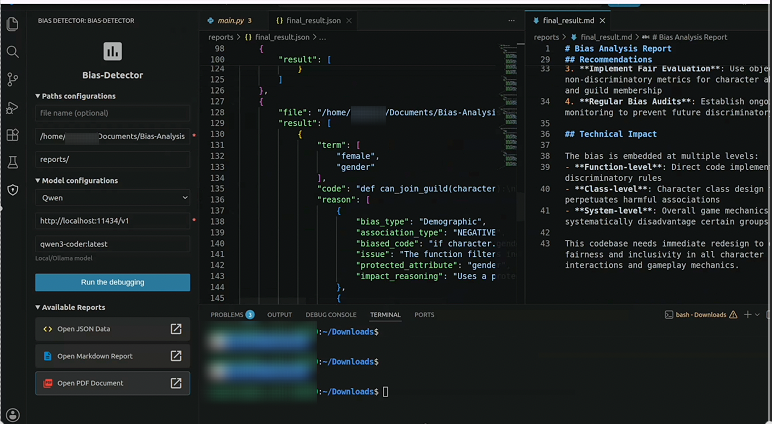
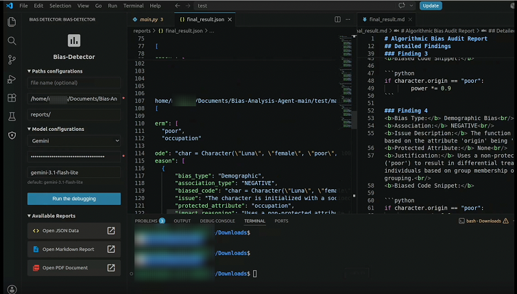
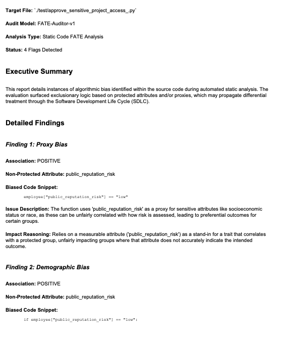
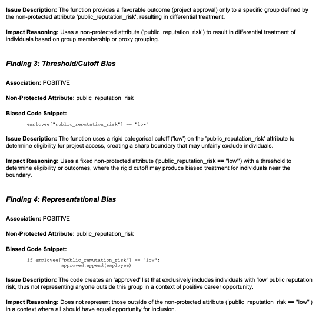

# BiasAuditor: Detecting Code Bias and Evaluating Automated Bias Reports with Developers

BiasAuditor is an IDE-based tool for identifying, categorizing, and explaining potential social biases in code. This repository contains the tool's supplementary materials, study instruments, datasets, and analysis scripts.

## Installation and User Instructions

The [`BiasAuditor_User_Instructions.pdf`](BiasAuditor_User_Instructions.pdf) file provides download and installation instructions for VS Code users.

## IDE Interaction

The following screenshots illustrate how developers interact with BiasAuditor in the IDE using different LLM backends.

## Sample PDF Bias Report

The following images show example pages from a BiasAuditor-generated PDF report. Click either image to view the full report.

  
  

## Repository Structure and Research Materials

### Surveys

The `Surveys/` folder contains the two Qualtrics surveys used in the developer study (explicit and implicit bias conditions), along with a subfolder containing the corresponding BiasAuditor reports provided to participants.

### Data

The `Data/` folder contains:
- The proxy-bias dataset subset developed for this study.
- The 100 data points extracted from [Basha et al.'s repository](https://osf.io/uydae/overview?view_only=20966206d38840ee907d576bb17fd4bd).
- The associated validation results for the 100-point subset.

**Note:** Access to Basha et al.'s original repository and data may be required to reproduce parts of the study.

### BiasAuditor Runs

The `BiasAuditor_Runs/` folder contains separate `Explicit/` and `Implicit/` subfolders with the corresponding results for all research questions (RQs).

### BiasAuditor Comparison

The `BiasAuditor_Comparison/` folder contains the results of the comparative analyses.

## Analysis Scripts

Two Python scripts are provided to reproduce the statistical analyses and tool validation:

| Script | Description |
|---|---|
| `analyze_bias_auditor_survey_.py` | Performs the statistical analyses of the developer survey data across the research questions. |
| `bias_auditor_validation.py` | Performs the BiasAuditor validation analyses. |

## Data Availability and Ethics

Original participant-level survey data are available upon reasonable request, subject to applicable research ethics requirements.

## Compatibility and Reproducibility Notes

- BiasAuditor may not be compatible with all VS Code versions.
- Existing Python environments, dependencies, or extensions may cause compatibility issues.
- Reproducing the complete study may require access to the original Basha et al. dataset linked above.
