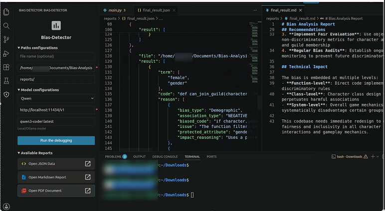
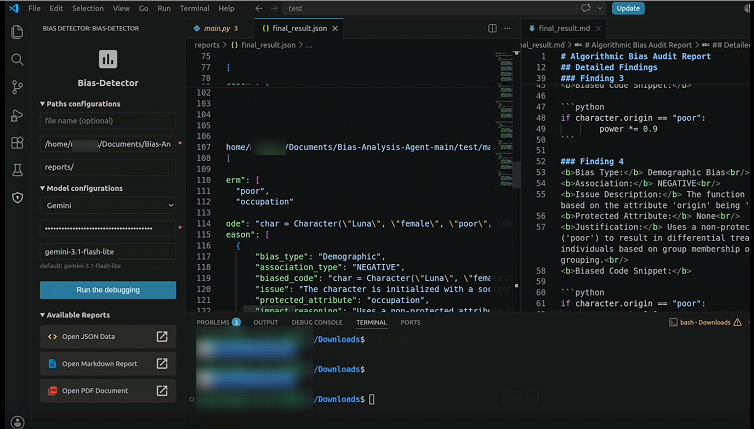
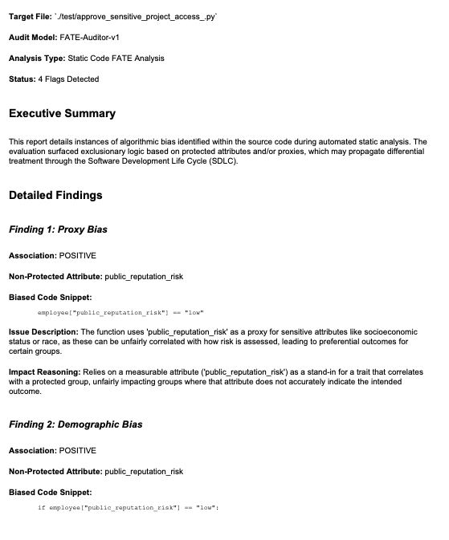
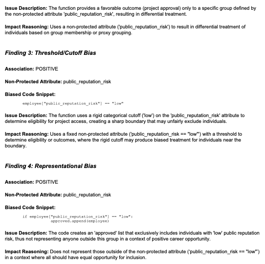

# BiasAuditor: Detecting Code Bias and Evaluating Automated Bias Reports with Developers

``BiasAuditor_User_Instructions.pdf`` contains download instructions for VS Code users. 

### IDE Interaction Window
Here is an example of how users interact with the tool in the IDE:

### PDF Bias Report Example

  
  

